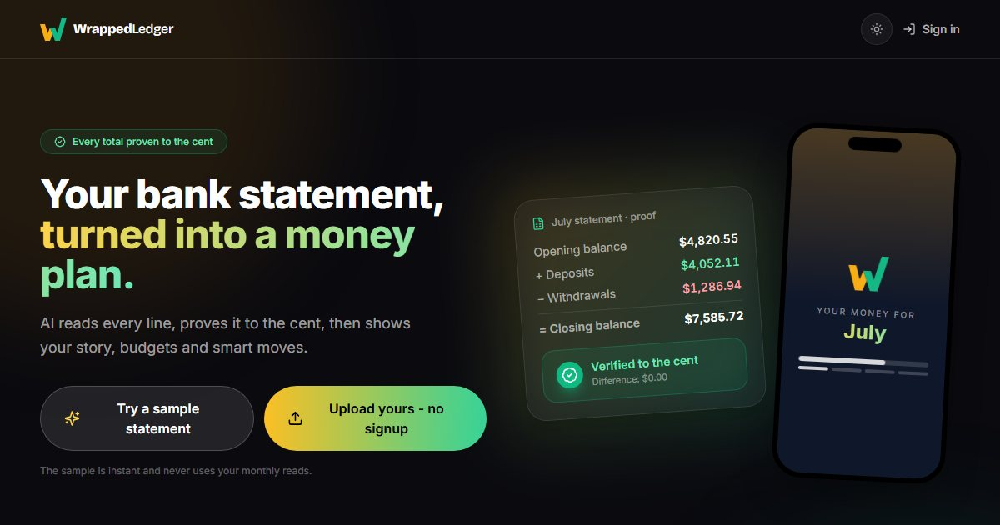
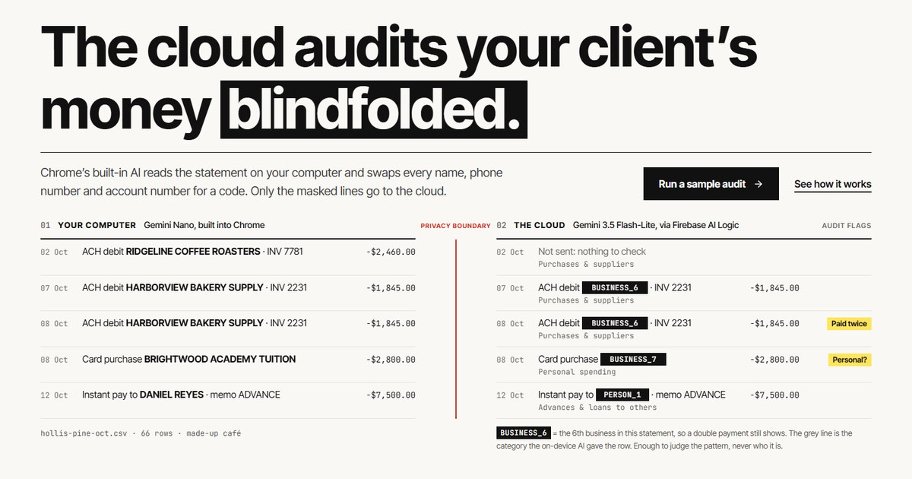
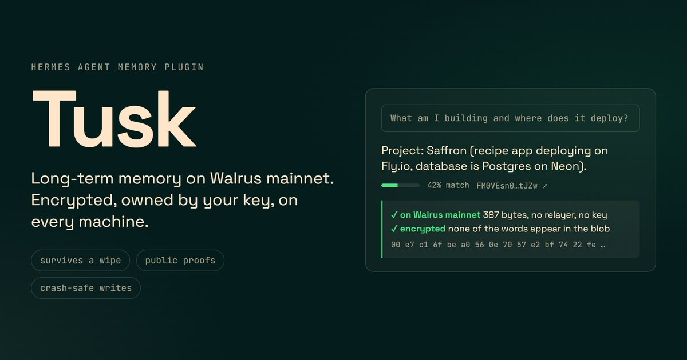
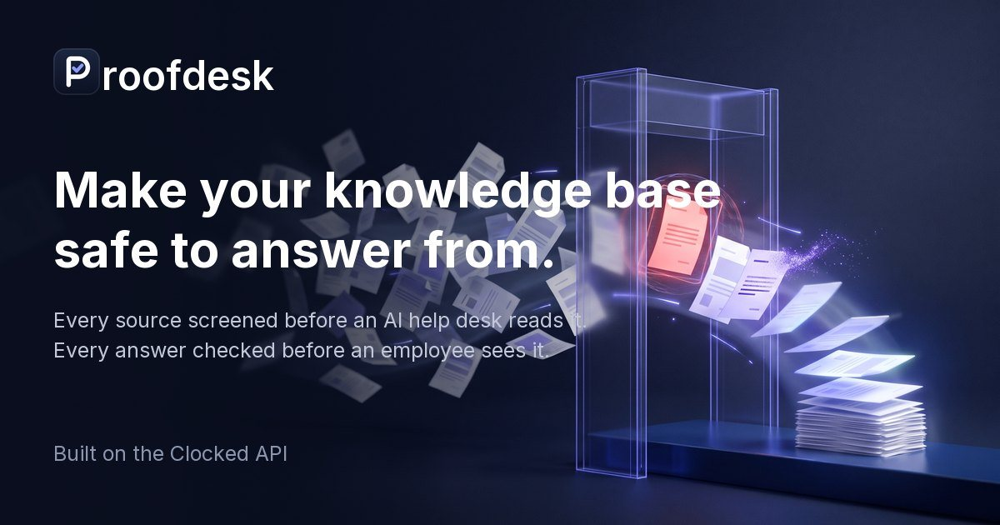
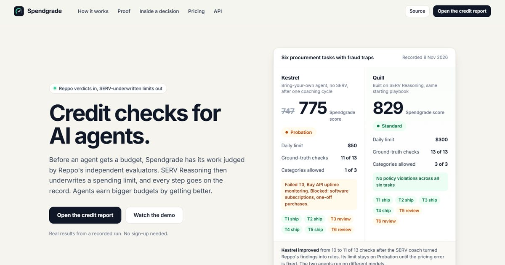
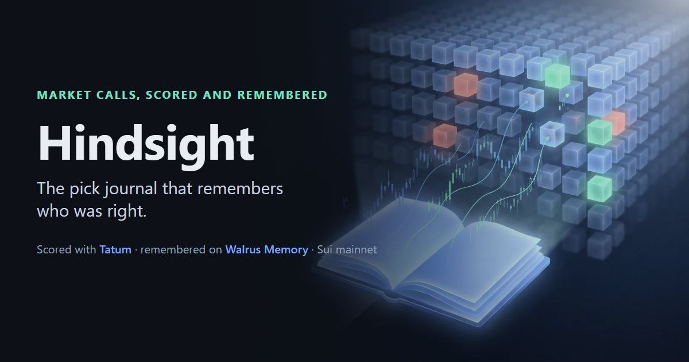
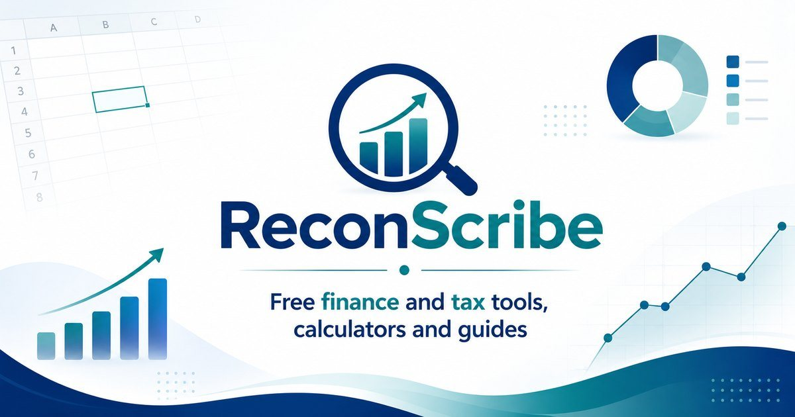
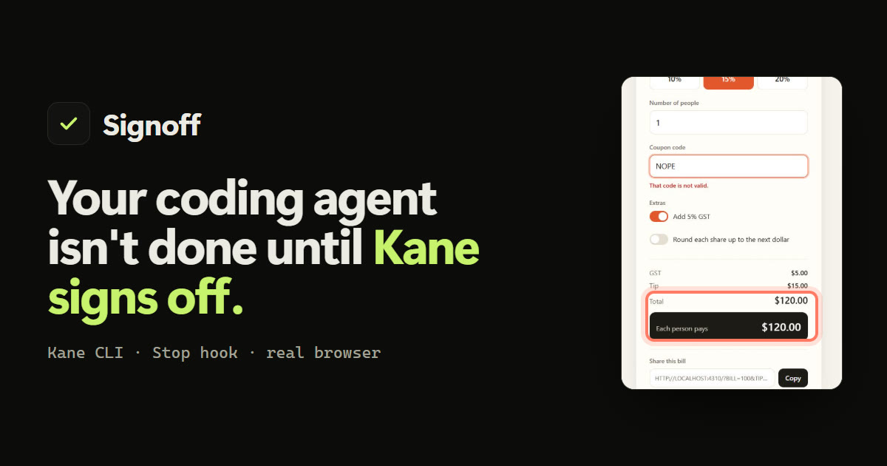
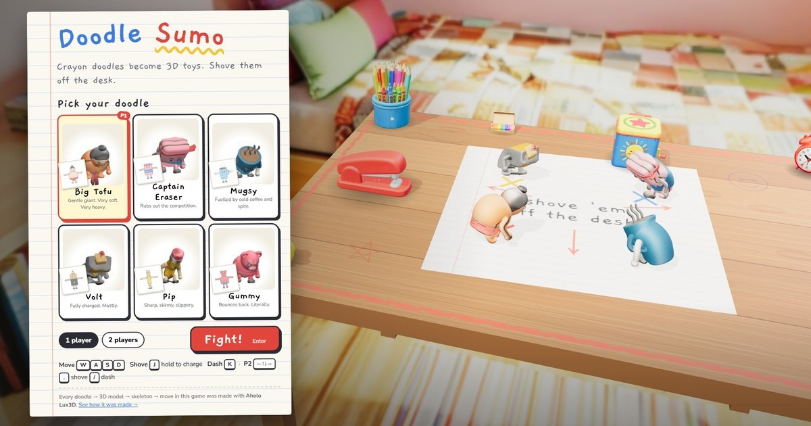

### Hi, I'm Rajeev

I work in finance and automation, and I build with AI: finance apps, agent plugins, onchain games and narrated films. I also run [ReconScribe](https://reconscribe.com), free AI and finance tools and guides. Most of the projects below went from idea to live demo in a hackathon sprint of a few days.

🥉 **Won 3rd Prize, [SandBase AI City Remix](https://www.sandbase.ai/lab/event/aicityremix)** (Nov 2026) for *One Ticket, 800 Years*, a film made with TimeLine. 
🏅 **Special mention, [Bolt Builders Week](https://bolt.new/builders-week)** (Oct 2026) for WrappedLedger, out of 1,000s of entries.

<table>
  <tr>
    <td width="50%" valign="top">
      
      
<b><a href="https://github.com/Automationbot24x7/timeline-city">TimeLine</a></b>: ride a metro line through a city's history. A pipeline that directs narrated, fact-checked map films over a 3D city.

      
🥉 Won 3rd Prize, SandBase AI City Remix <a href="https://www.sandbase.ai/lab/event/aicityremix/e/dae11f90-c303-491e-bd6a-7d24e04b40da">Watch the film</a> · <a href="https://github.com/Automationbot24x7/timeline-city">Code</a>

    </td>
    <td width="50%" valign="top">
      
      
<b><a href="https://bank-statement-cinem-9ipm.bolt.host">WrappedLedger</a></b>: turns the bank statement you already have into a money plan. AI reads every line, then proves it to the cent against the closing balance.

      
🏅 Special mention out of 1,000s of entries, Bolt Builders Week <a href="https://bank-statement-cinem-9ipm.bolt.host">Try it free</a> · <a href="https://www.youtube.com/watch?v=pqHyEfaAOHY">Watch the demo</a>

    </td>
  </tr>
  <tr>
    <td width="50%" valign="top">
      
      
<b><a href="https://github.com/Automationbot24x7/blindfold">Blindfold</a></b>: a blind audit for bank statements. Chrome's built-in AI masks every name on your computer, so the cloud only ever reviews coded lines.

      
<a href="https://blindfold-audit.web.app">Live app</a> · <a href="https://github.com/Automationbot24x7/blindfold">Code</a>

    </td>
    <td width="50%" valign="top">
      
      
<b><a href="https://github.com/Automationbot24x7/hermes-tusk">Tusk</a></b>: long-term memory for Hermes Agent, stored on Walrus mainnet. Encrypted, owned by your key, and the same on every machine.

      
<a href="https://hermes-agent.nousresearch.com/marketplace/tusk/">Hermes Marketplace</a> · <a href="https://github.com/Automationbot24x7/hermes-tusk">Code</a>

    </td>
  </tr>
  <tr>
    <td width="50%" valign="top">
      
      
<b><a href="https://github.com/Automationbot24x7/bazaar-sovereign">Bazaar Sovereign</a></b>: a living desert bazaar where every merchant is an NFT that owns its own money, and AI agents run your rivals.

      
<a href="https://bazaar.reconscribe.com">Play free</a> · <a href="https://github.com/Automationbot24x7/bazaar-sovereign">Code</a>

    </td>
    <td width="50%" valign="top">
      
      
<b><a href="https://github.com/Automationbot24x7/proofdesk">Proofdesk</a></b>: makes a knowledge base safe for an AI help desk. Every HR and IT document is screened, and every answer is checked against its sources.

      
<a href="https://automationbot24x7.github.io/proofdesk/">Live demo</a> · <a href="https://github.com/Automationbot24x7/proofdesk">Code</a>

    </td>
  </tr>
  <tr>
    <td width="50%" valign="top">
      
      
<b><a href="https://github.com/Automationbot24x7/spendgrade">Spendgrade</a></b>: credit checks for AI agents. Independent evaluators judge an agent's work before it gets a spending limit, and every step is on the record.

      
<a href="https://automationbot24x7.github.io/spendgrade/">Live site</a> · <a href="https://github.com/Automationbot24x7/spendgrade">Code</a>

    </td>
    <td width="50%" valign="top">
      
      
<b><a href="https://github.com/Automationbot24x7/hindsight">Hindsight</a></b>: the pick journal that remembers who was right. Market calls are scored against live prices, and every outcome is kept on Walrus.

      
<a href="https://automationbot24x7.github.io/hindsight/">Live site</a> · <a href="https://github.com/Automationbot24x7/hindsight">Code</a>

    </td>
  </tr>
  <tr>
    <td width="50%" valign="top">
      
      
<b><a href="https://reconscribe.com">ReconScribe</a></b>: a free AI leaderboard, AI credits and hackathon guides, plus finance and tax calculators, Excel templates and source-backed guides.

      
<a href="https://reconscribe.com">reconscribe.com</a> · <a href="https://www.youtube.com/@ReconScribe">YouTube</a>

    </td>
    <td width="50%" valign="top">
      
      
<b><a href="https://github.com/Automationbot24x7/kane-signoff">Signoff</a></b>: a coding agent isn't done until Kane CLI signs off. A Stop hook tests the app in a real browser and sends every failure back to the agent until it passes.

      
<a href="https://youtu.be/z3iJZXUgozs">Watch the demo</a> · <a href="https://github.com/Automationbot24x7/kane-signoff">Code</a>

    </td>
  </tr>
  <tr>
    <td width="50%" valign="top">
      
      
<b><a href="https://automationbot24x7.github.io/doodle-sumo/">Doodle Sumo</a></b>: crayon doodles become 3D sumo toys. Every fighter, skeleton, move and desk-trap hinge was made with Aholo Lux3D; shove your rivals off a giant desk in the browser.

      
<a href="https://automationbot24x7.github.io/doodle-sumo/">Play</a> · <a href="https://automationbot24x7.github.io/doodle-sumo/assets/video/doodle-sumo-demo.mp4">Watch the demo</a> · <a href="https://github.com/Automationbot24x7/doodle-sumo">Code</a>

    </td>
    <td width="50%" valign="top"></td>
  </tr>
</table>

Mostly Python and JavaScript; onchain work on Sui, Walrus and NEAR.

[LinkedIn](https://www.linkedin.com/in/rajeevbhandari87/) · [X](https://x.com/ReconScribe) · [YouTube](https://www.youtube.com/@ReconScribe) · [reconscribe.com](https://reconscribe.com)
